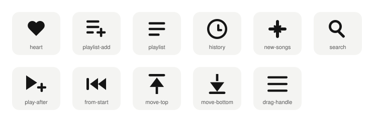

# HUUKPLAY icons

Simple icons drawn for the HUUKPLAY music app, shared openly so anyone can use them.



| Icon | File | Used for |
|---|---|---|
| Heart | `svg/heart.svg` | Favorite |
| Playlist + | `svg/playlist-add.svg` | Add to a playlist |
| Playlist | `svg/playlist.svg` | Playlists |
| History | `svg/history.svg` | Songs played |
| New songs | `svg/new-songs.svg` | New this week |
| Search | `svg/search.svg` | Search |
| Play after | `svg/play-after.svg` | Play after this song |
| From start | `svg/from-start.svg` | Play from the very beginning |
| Move to top | `svg/move-top.svg` | Move to top |
| Move to bottom | `svg/move-bottom.svg` | Move to bottom |
| Drag handle | `svg/drag-handle.svg` | Hold and drag to reorder |

## Use them

- **SVG** (`svg/`): the icons use `currentColor`, so they take the colour of the text around them. Scale them to any size.
- **React Native** (`react-native/huukplay-icons.tsx`): the same icons drawn from plain shapes (Views), with no font or image files. Each takes `color` and `size`:

```tsx
import { HeartIcon, MoveIcon } from './huukplay-icons';

<HeartIcon color="#E85D45" />
<MoveIcon color="#151515" direction="top" />
```

## Licence

The icons are licensed under **Creative Commons Attribution 4.0 International (CC BY 4.0)**:
https://creativecommons.org/licenses/by/4.0/

You may use, share and change them for any purpose, including commercial, as long as you give credit, for example:

> Icons by HUUKPLAY (https://github.com/huukplay/huukplay-icons), CC BY 4.0

## Not included

The **HUUKPLAY name and logo** are trademarks of HUUKPLAY. They are not in this repository and are not covered by this licence.

First published 2026 by HUUKPLAY.
